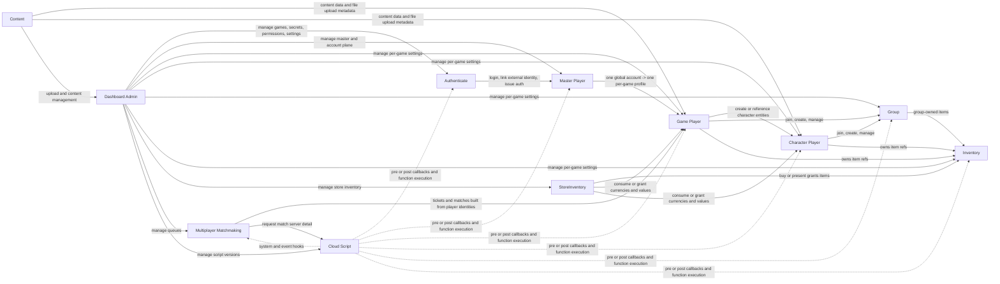

# Domain Relationship Map

This document explains the logical relationship between the main GearN domains so an AI agent can understand where a feature belongs before editing code.

## Core Domain Graph

## Short Meaning Of Each Domain

### Authenticate

- Entry point for login and token refresh.
- Resolves account identity from account credentials or third-party providers.
- Produces `AuthInfo`, then connects the session to a `MasterPlayer`.

### Master Player

- Global account-level identity across games.
- Owns external login bindings, email, push notification data, and global player-like state.
- This is the account plane, not the per-game gameplay plane.

### Game Player

- Per-game player profile for a `MasterPlayer`.
- Holds per-game data such as currencies, statistics, data fields, groups, inventories, friends, and character references.
- This is the main gameplay profile most features work against.

### Character Player

- Character-scoped entity inside a game.
- In this codebase it is not a tiny child record. It extends `GamePlayerBase`, so it also has player-like state such as currencies, statistics, data, tags, custom data, group refs, and inventory refs.
- Use this when a game models multiple playable characters per account.

### Group

- Shared entity with members and group-owned state.
- Can hold currencies, statistics, data, inventories, tags, segments, and remove status.
- Related from player and character modules through membership references.

### Inventory

- Item entity with owner-based linkage.
- Can belong to a game player, character player, or group through the `owner` field.
- Used as the concrete place where item state exists.

### Content

- Content and upload support domain.
- Handles content data plus file upload and download metadata.
- Not the main gameplay state, but it supports game/admin flows.

### StoreInventory

- Store offer definition and purchase domain.
- Describes what is sold, prices, grant payloads, and in-app purchase mapping.
- This is exposed to the public client SDK as `StoreInventory`, which also matches `RequestType.StoreInventory`.
- A store item is not the same as a concrete inventory item. Store inventory operations usually end by mutating inventory or player state.

### Dashboard Admin

- Control plane for the whole server.
- Manages admin login, games, permissions, secrets, master game settings, analytics, cloud script, and maintenance actions.
- This domain configures and governs other domains more than it behaves like gameplay itself.

### Multiplayer Matchmaking

- Handles queueing, tickets, and match creation.
- Works mainly from player identity and queue settings.
- When a match needs runtime server information, it requests that detail through callback or cloud-script-driven flows.

### Cloud Script

- Runtime extension mechanism.
- Stores versioned scripts, executes functions in worker processes, and participates in event callbacks.
- Cross-cuts many domains instead of belonging to one entity family.

## Practical Relationship Rules

### Identity Layers

- `Authenticate` creates or validates session identity.
- `MasterPlayer` is the global account identity.
- `GamePlayer` is the per-game profile identity.
- `CharacterPlayer` is the per-character profile identity inside one game.

This means account-level changes should usually start from `MasterPlayer`, while gameplay changes should usually start from `GamePlayer` or `CharacterPlayer`.

### Ownership Layers

- `Inventory` is owned by some other domain object.
- `Group` can own inventory.
- `GamePlayer` can own inventory.
- `CharacterPlayer` can own inventory.

If you are changing item state, check who owns the item before deciding which handler family to modify.

### Control Plane vs Gameplay Plane

- `Dashboard Admin` changes configuration, permissions, secrets, analytics, and operational data.
- `Authenticate`, `GamePlayer`, `CharacterPlayer`, `Group`, `Inventory`, `StoreInventory`, and `Multiplayer` are mostly runtime gameplay or live-service paths.

Do not mix dashboard-style management logic into gameplay handlers unless the existing design already does that.

### Cross-Cutting Domains

- `Cloud Script` can intercept or extend many flows.
- `Content` supports both gameplay-facing and admin-facing operations.
- `StoreInventory` often affects `Inventory`, `GamePlayer`, or `CharacterPlayer` together.
- `Multiplayer` depends on player identity and can call out to `Cloud Script`.

## Where These Domains Live In Code

- Request registration: `src/RequestControllerUtils.ts`
- Dispatch: `src/GN-app-api/handler/controller/RequestController.ts`
- Startup wiring: `src/GN-startup/ServerApplication.ts`
- Runtime coordinator: `src/GNServer.ts`

Main entity examples:

- `src/GN-library/xdatabase/lib/entity/pro/MasterPlayer.ts`
- `src/GN-library/xdatabase/lib/entity/pro/GamePlayer.ts`
- `src/GN-library/xdatabase/lib/entity/pro/CharacterPlayer.ts`
- `src/GN-library/xdatabase/lib/entity/pro/Group.ts`
- `src/GN-library/xdatabase/lib/entity/pro/Inventory.ts`
- `src/GN-library/xdatabase/lib/entity/pro/StoreInventory.ts`
- `src/GN-library/xdatabase/lib/entity/pro/MatchmakingTicket.ts`
- `src/GN-library/xdatabase/lib/entity/pro/Match.ts`

## Editing Guidance For AI

- If the change is about login, token, external identity, or session, inspect `Authenticate` and `MasterPlayer` first.
- If the change is gameplay state inside one game, inspect `GamePlayer`, then check whether the feature is actually character-scoped, group-scoped, or item-scoped.
- If the change is admin tooling or server configuration, inspect `Dashboard`.
- If the change is callback, scripting, or runtime extensibility, inspect `Cloud Script`.
- If the change is purchase flow, inspect `StoreInventory` together with the target state mutation domain.

## Important Caveat

These relationships are logical runtime relationships. The project does not rely on strict relational foreign keys. Many connections are maintained through IDs, references embedded in documents, handler orchestration, and service-layer coordination.
